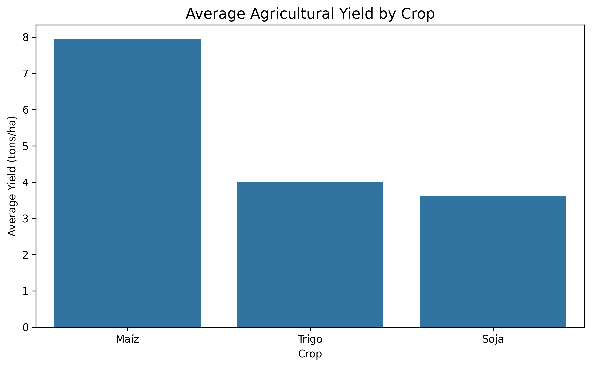
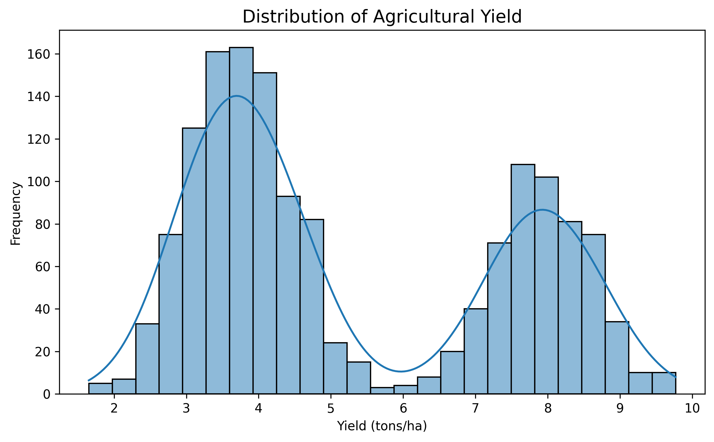
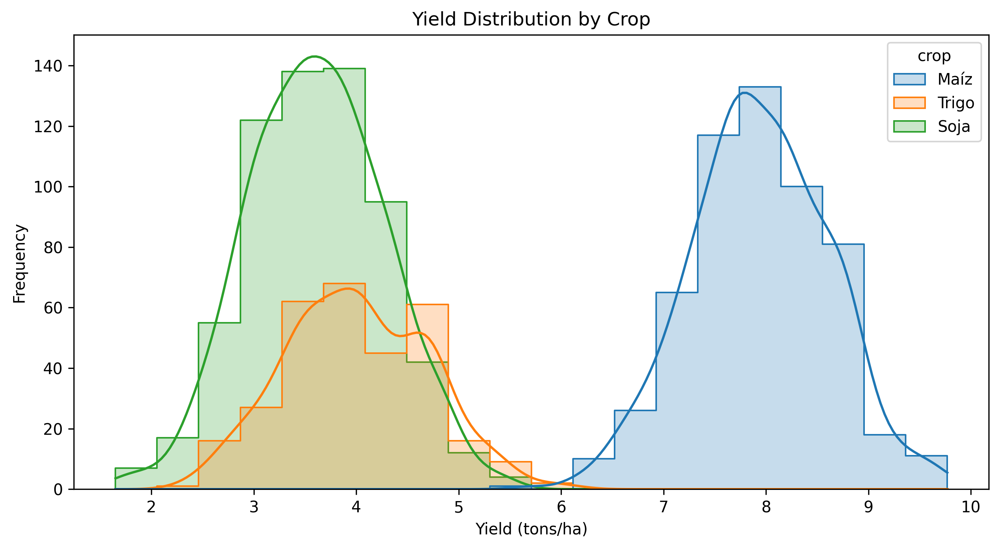
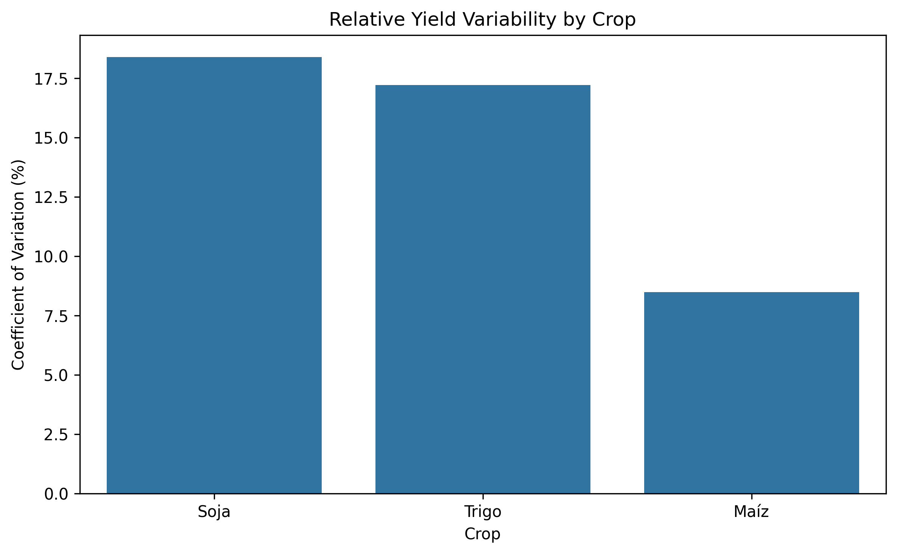
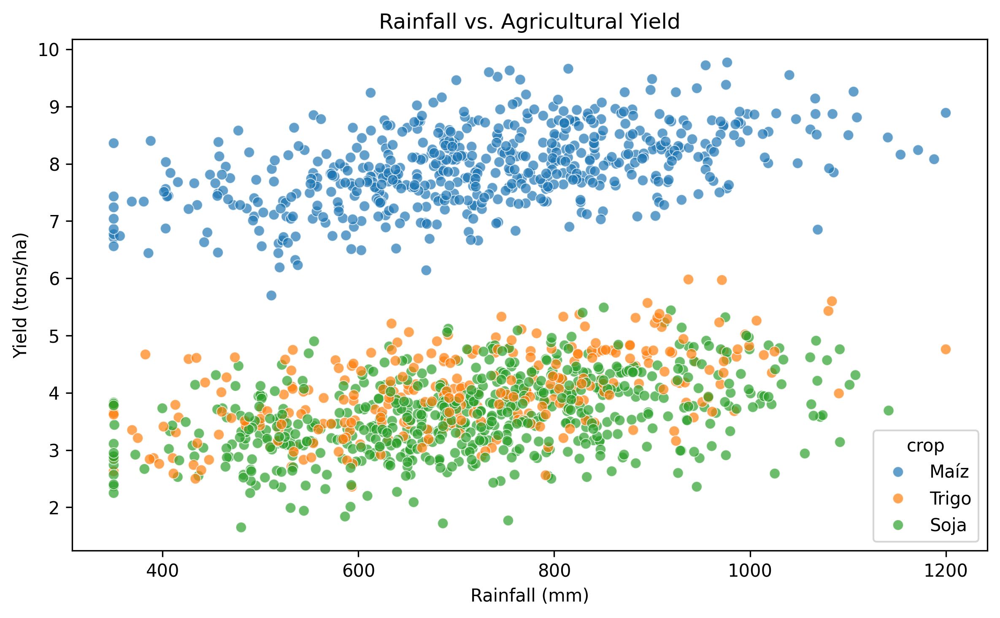

# agricultural-yield-analysis
Exploratory data analysis and machine learning for agricultural yield prediction using Python, Pandas, Matplotlib, Seaborn, and Scikit-learn. Based on a simulated dataset.

## Project Overview

This project explores agricultural yield data using Python to identify patterns, analyze relationships between environmental and crop-related variables, and develop predictive models.

The analysis combines data analytics and machine learning with an agricultural perspective to investigate how crop type, rainfall, soil moisture, and vegetation indices relate to crop yield.

**Note:** This project uses a simulated dataset created for educational and portfolio purposes. The findings do not represent real agricultural observations.

## Objectives

- Perform exploratory data analysis (EDA).
- Identify patterns and relationships between agricultural variables.
- Compare Linear Regression and Random Forest models.
- Evaluate model performance using MAE, RMSE, and R².
- Analyze feature importance and prediction errors.
- Interpret results considering the differences between crop types.

## Tools & Technologies

- Python
- Pandas and NumPy
- Matplotlib and Seaborn
- Scikit-learn
- Google Colab

## Key Skills Demonstrated

Data cleaning, exploratory data analysis, data visualization, data preprocessing, machine learning, model evaluation, and data-driven interpretation in an agricultural context.

## Dataset

The project uses a synthetic agricultural dataset containing 1,500 observations. It was created for educational and portfolio purposes and does not represent real field measurements.

The dataset includes variables related to crop type, soil properties, weather conditions, vegetation indices, agricultural management practices, and crop yield.

### Main Variables

| Category | Variables | Description |
|---|---|---|
| Identification | `field_id`, `region`, `campaign` | Field, region, and growing campaign identifiers |
| Crop | `crop` | Crop type: soybean, maize, or wheat |
| Soil properties | `soil_ph`, `organic_matter_pct`, `soil_moisture_pct` | Soil characteristics |
| Weather | `rainfall_mm`, `temperature_avg_c` | Rainfall and average temperature |
| Management | `fertilizer_kg_ha`, `irrigation` | Fertilizer application and irrigation status |
| Vegetation indices | `ndvi`, `gndvi`, `ndwi`, `savi` | Vegetation and surface indices |
| Target variable | `yield_tn_ha` | Crop yield in metric tons per hectare |

### Dataset File

The dataset is available in [`agricultural_yield_dataset.csv`](agricultural_yield_dataset.csv).

## Limitations

Since the dataset is simulated, the results are intended to demonstrate analytical methods and technical skills rather than draw conclusions about real-world agricultural production.

## Exploratory Data Analysis

### 1. Average Yield by Crop

**Key finding**

Maize has the highest average yield in the simulated dataset, followed by wheat and soybean. These differences are descriptive and do not indicate crop profitability or real-world agronomic performance.

### 2. Overall Yield Distribution

**Key finding**

The histogram shows the distribution of yield values across all observations. This provides an overview of the variability in the simulated dataset.

### 3. Yield Distribution by Crop

**Key finding**

Yield distributions differ across crop types. Maize observations tend to be concentrated at higher yield values in this simulated dataset.

### 4. Yield Variability by Crop

**Key finding**

Wheat has the highest standard deviation, while soybean has the highest coefficient of variation in the simulated dataset. Standard deviation measures absolute dispersion, whereas the coefficient of variation measures variability relative to the mean.

### 5. Rainfall vs. Yield

**Key finding**

The scatter plot explores the relationship between rainfall and yield across crop types. Any observed association is descriptive and does not establish causation or validated agronomic relationships.

**Important note:** All findings are based on simulated data and are intended for educational and portfolio purposes.

## Key Findings

### Crop Yield Comparison

The average yield varied across crop types in the simulated dataset:

| Crop | Average Yield (tons/ha) |
|---|---:|
| Maize | 7.94 |
| Wheat | 4.01 |
| Soybean | 3.61 |

Maize had the highest average yield among the three crop types. However, these values are based on synthetic data and should not be interpreted as actual agricultural benchmarks.

### Relationships Between Variables

The exploratory analysis identified positive correlations between rainfall and yield across all three crop types in the simulated dataset.

Vegetation indices, particularly NDVI, also showed positive correlations with yield.

These relationships are descriptive and do not establish causation. Since the dataset is synthetic, they should not be used to draw real-world agronomic conclusions.

### Data Variability

Yield variability differed across crop types. Wheat showed the highest standard deviation, while soybean showed the highest coefficient of variation.

This comparison illustrates why both absolute and relative measures of variability are useful when analyzing agricultural data.

